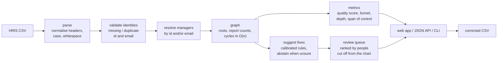

# Diversio SDE Intern Project: HRIS Import Validator & Org-Health Analytics

[](https://github.com/vanshajvr/diversio-hris-exercise/actions/workflows/ci.yml)

Validates employee CSV exports from an HRIS, measures how healthy the resulting org chart is, and
helps an HR admin fix broken manager references. The suggested fixes have a **measured precision**,
not just a plausible one.

This started as the take-home for Diversio's SDE intern role: parse an HRIS export, validate identities,
resolve managers, and report roots, direct-report counts and reporting cycles. I then extended it into a
small product. It now measures what the validator misses, suggests fixes calibrated on held-out data,
and puts everything into a review queue ranked by impact.

## Results

All numbers come from the commands in [Reproduce](#reproduce). The method is in each write-up.

| Question | Answer | Write-up |
|---|---|---|
| Does the validator catch every detectable corruption? | **Yes, with the right issue code, and 0 false alarms** across 300 synthetic orgs (150,000 rows, 17,406 labelled corruptions) | [detection benchmark](docs/detection-benchmark.md) |
| What does it miss? | With sequential IDs, **19.7%** [15.7–24.4%] of `manager_id` typos land on another real employee and import silently. With `manager_email` also supplied: **0%** [0–2.1%] | [detection benchmark](docs/detection-benchmark.md) |
| How good are the suggested fixes? | At the 0.80 operating point, on held-out orgs: **99.4% precise**, recovering **90.2%** of fixable references. It wrongly proposes a manager on only **37 of 3,906** rows whose manager has left | [suggestion benchmark](docs/suggestion-benchmark.md) |
| Can the confidence scores be trusted? | Yes: each rule's stated confidence falls inside or just below its held-out 95% interval | [suggestion benchmark](docs/suggestion-benchmark.md) |
| What does it do for an admin? | On a messy 500-person org: 22 pre-selected fixes reconnect **37 people** and raise data quality from **93.8 to 96.8**. The downloaded file re-validates to exactly that | [PRD](docs/PRD.md) |
| Is it fast enough? | 50,000 rows (4 MB): validation and metrics in **0.36s**, full review with suggestions in **1.6s** | [below](#complexity) |

## How it works



Each issue gets a **code** (`MANAGER_NOT_FOUND`, `DUPLICATE_EMAIL`, `REPORTING_CYCLE`, …) and a
**severity**:
- **Error:** the row (or whole file) is rejected.
- **Warning:** the row is kept but left out of the hierarchy.

The codes are what make the funnel, the Pareto view and the benchmarks possible.

### How the claims are tested

A [synthetic org generator](src/hris_import/synthetic.py) builds realistic orgs (6–7 layers at 500
people, median span 4–5, rows shuffled so managers often come after their reports) and injects **10 kinds of labelled
corruption**: typos, format drift, legacy email domains, departed managers, cycles, duplicates. Two of
them are negative controls that must *not* raise anything. Every benchmark scores the real pipeline
against those labels, and CI asserts the key findings on every push.

## Quick start

```bash
python3 -m venv venv && source venv/bin/activate
pip install -e ".[dev]"

uvicorn hris_import.web:app --reload        # open http://127.0.0.1:8000, upload data/synthetic_org_500.csv
pytest                                      # 96 tests
ruff check .
```

### CLI

| Command | What it does |
|---|---|
| `hris-import report FILE [--json]` | Data quality score, import funnel, layers, span of control, largest orgs, departments, issue counts |
| `hris-import suggest FILE [--threshold 0.8] [--json]` | A proposed manager for each broken reference, with the evidence |
| `hris-import generate OUT.csv [--size 500 --seed 42]` | A messy synthetic org plus `OUT_truth.json` labels |
| `hris-import benchmark [--suggestions] [--seeds 100]` | Re-run the detection or suggestion benchmark |

### Web and API

- `GET /`: upload page
- `POST /upload`: KPI tiles, review queue with evidence, projected impact, funnel, org health
- `POST /apply`: downloads `corrected.csv`, changing only the approved manager cells
- `POST /api/preview`: everything above as JSON

The app stores nothing. The uploaded file travels back with the fix form.

## Repository layout

```
src/hris_import/
  parser.py       CSV -> rows; header/case/whitespace normalisation; true source line numbers
  validator.py    identity checks and manager resolution, each issue coded with a severity
  graph.py        roots, direct-report counts, O(n) cycle detection
  pipeline.py     orchestration (no web dependency, so it's testable directly)
  metrics.py      org-health and data-quality metrics
  synthetic.py    realistic org generator with labelled corruptions
  evaluation.py   detection and suggestion benchmarks, Wilson intervals, calibration
  suggestions.py  rule-based fix suggestions with calibrated confidence
  review.py       impact-ranked review queue, projection, corrected-CSV writer
  web.py          FastAPI app + structured product events
  __main__.py     CLI
docs/             detection-benchmark.md, suggestion-benchmark.md, PRD.md
data/             original sample + a 500-person messy org with ground truth
tests/            96 tests: unit, property-style checks on random orgs, web round trip
```

## Design decisions

**Validation rules**
- **Both manager fields blank means a real root.** That's different from an employee whose manager
  reference failed to resolve: that employee is kept, but isn't a root and gets no reporting edge.
- **If both `manager_id` and `manager_email` are given, they must name the same person.** The detection
  benchmark later showed why this matters: it's what catches ID typos that land on a real ID.
- **Duplicate IDs or emails reject every copy.** A duplicate can't be anyone's manager, because we
  can't know which copy is real.
- **Only employees strictly inside a cycle are flagged.** Someone reporting *into* a loop is
  disconnected but not cyclic.
- **Emails are compared case-insensitively. IDs are compared exactly,** and format drift like
  `emp 1234` is handled by the suggestion engine, where it's visible and reversible, not silently by the validator.
- **Blank and comma-only lines are skipped.** Row numbers stay true to the source file, even when a
  quoted field spans several lines.

**Suggested fixes**
- **Rules, not a model.** Every suggestion says which evidence it used, so an admin can check it in
  seconds. The engine abstains when several rows share one missing manager (probably someone who left),
  when candidates are ambiguous, or when the fix would create a loop.
- **Confidence is measured, not asserted.** Each rule's value is its precision on 300 calibration orgs,
  and results are reported on 300 different orgs. A test fails if they drift apart.
- **The 0.80 threshold is a product decision backed by the threshold curve.** See the
  [PRD](docs/PRD.md#why-080).

**Framework.** The exercise preferred Django, but I used FastAPI because it's what I've built with
before. All the logic is framework-free; FastAPI only touches `web.py`.

## Complexity

- **Parsing, identity checks and manager resolution:** O(n). They use Counters for duplicates and dicts
  for O(1) lookups, never list scans.
- **Cycle detection:** O(n). Each employee has at most one manager, so the hierarchy is a *functional
  graph*. A visiting/done state map means every node is walked once in total, not once per starting point.
- **Suggestions:** O(L·|Σ|) per broken reference. Instead of comparing against all n IDs, the engine
  generates every string one edit away and looks each up in a set.
- **Measured:** 50,000 rows validate and score in 0.36s, and the full review takes 1.6s. Memory, not
  time, is the limit: the file is read whole, capped at 5 MB.

## What went wrong along the way

- **Case-sensitive emails.** The original parser didn't lowercase `email` and `manager_email`, which
  silently broke manager resolution for mixed-case rows. My tests missed it; I found it by running the
  real sample. There's now a regression test.
- **The synthetic orgs were unrealistic at first.** The first generator produced 19 layers for 500
  people. I rebuilt it twice, settling on top-down headcount budgets, before the shape matched real orgs.
- **The first suggestion benchmark flattered the engine.** Every departed manager left two or more rows
  pointing at them, which made departures trivially detectable. Now they sometimes leave a single stale
  row, as happens when HR reassigns most of a team. That exposed real mistakes on those cases, which
  the benchmark now reports.
- **Confidence values were guesses.** One rule claimed 0.85 and was right 61% of the time. A
  department signal plus held-out calibration fixed it.
- **Analytics events passed their tests but were dropped in production.** pytest captures log records
  by itself, but under uvicorn the logger had no handler. I only caught it by checking the real
  server's log.

## Limitations

- **The synthetic orgs are plausible, not calibrated to a real company.** Departments are inherited
  strictly, so the department signal is likely weaker on real data with matrix reporting.
- **Typos are uniform single-character edits.** Real typos cluster (adjacent keys, doubled digits).
- **Reporting loops are flagged and ranked, but not auto-fixed.** Choosing which edge to break needs a
  human or HRIS history.
- **The whole file is read into memory** (5 MB cap). A streaming parser would be the next step for
  larger exports.

## Roadmap

1. Log `suggestion_decided` events and **recalibrate confidence on real admin decisions** ([PRD](docs/PRD.md#launch-plan)).
2. Run the review queue against the current error list as an experiment (sample size and fallbacks are in the PRD).
3. Suggest which edge to break in a reporting loop, using whichever choice reconnects the most people.
4. Stream large files instead of reading them whole.

## Reproduce

```bash
hris-import benchmark --seeds 100                 # detection tables (~3s)
hris-import benchmark --suggestions --seeds 100   # suggestion tables (~18s)
hris-import generate data/synthetic_org_500.csv --seed 42
```

## AI tools used

- **Original take-home:** I used an AI assistant to scaffold the FastAPI/Jinja2 boilerplate and to talk
  through the cycle-detection approach. I wrote the validation and cycle-detection logic myself, traced
  the sample CSV by hand, and then wrote tests.
- **Extension (packaging through the review queue):** built with Claude Code as a pair programmer.
  Scope, product direction and which findings to keep were mine. Every number in the docs was re-run
  and checked before it went in.
